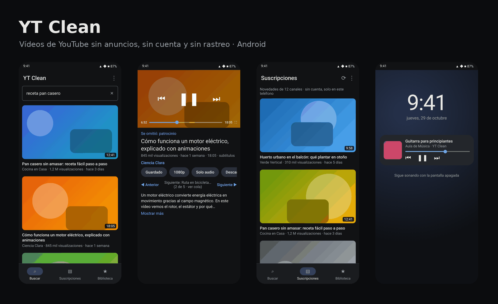
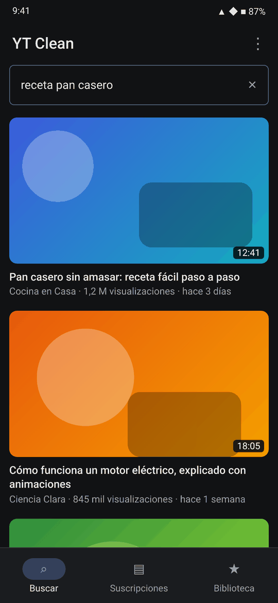
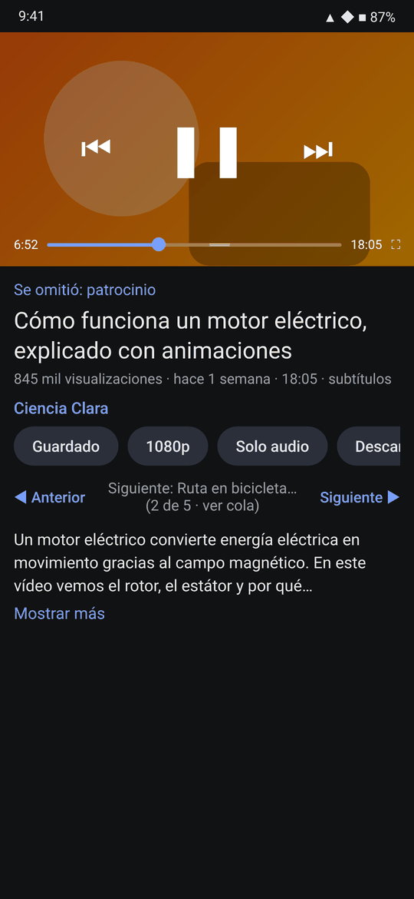
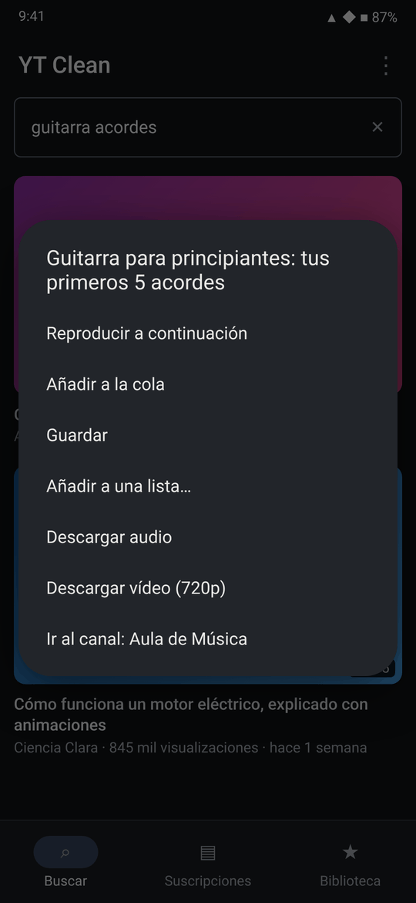
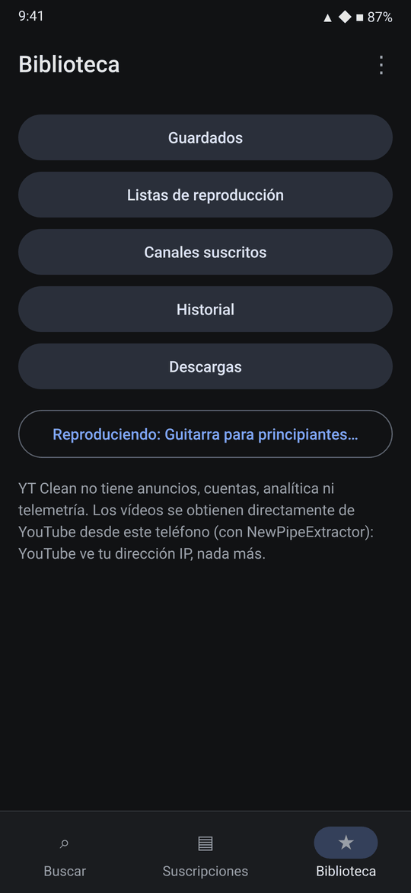
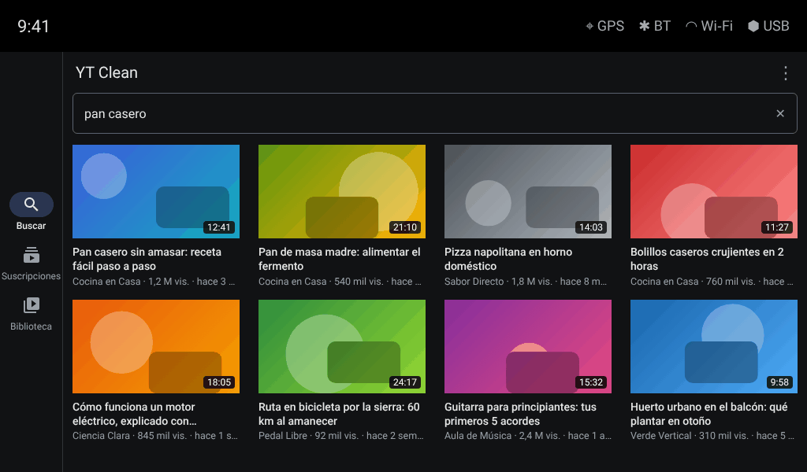
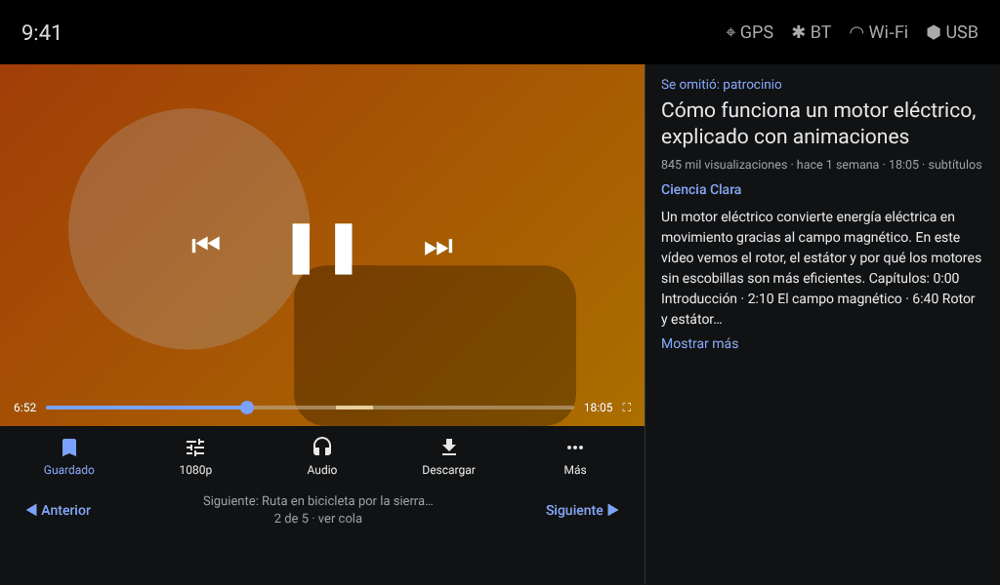

# YT Clean

**Vídeos de YouTube sin anuncios, sin cuenta y sin rastreo.** App Android nativa al estilo NewPipe/LibreTube: busca y reproduce nada más instalarla, sin servidor, sin clave de API y sin iniciar sesión.



<p align="center">
  <a href="https://github.com/web-gdl/YTClean/releases/latest/download/YTClean.apk"><b>⬇ Descargar YTClean.apk (última versión)</b></a>
  &nbsp;·&nbsp; <a href="https://github.com/web-gdl/YTClean/releases">Todas las versiones</a>
  &nbsp;·&nbsp; Android 7.0 o superior
</p>

**Última versión: 0.8.1** (30-oct-2026) · abre cualquier enlace de YouTube y puede quedar como app predeterminada para ellos. En 0.8.0 llegó la descarga en **MP3** de vídeos y listas enteras. Ver [novedades](#novedades).

> Las imágenes son ilustraciones de la interfaz con contenido de ejemplo (títulos y canales inventados), no capturas de vídeos reales.

## Qué hace

| | |
|---|---|
| 🔍 **Buscar** | Solo al enviar, sin tendencias ni recomendaciones. Desplazamiento infinito. Abre enlaces de YouTube compartidos o pegados. |
| ▶️ **Reproductor nativo** | ExoPlayer, sin el reproductor de YouTube ni sus anuncios. Calidad de 144p a 2160p, solo audio, subtítulos, pantalla completa e imagen en imagen. |
| 🎧 **Segundo plano** | Sigue sonando con la pantalla apagada, con controles en la notificación y en la pantalla de bloqueo. |
| ⏭ **SponsorBlock** | Salta patrocinios, autopromoción, recordatorios de suscripción y partes sin música. |
| 📺 **Suscripciones** | Sigue canales sin cuenta (solo en el teléfono) y consulta sus novedades en una pestaña propia. |
| 📚 **Biblioteca** | Guardados, listas de reproducción locales, cola (reproducir a continuación, añadir, saltar), canales e historial opcional. |
| ⬇ **Descargas** | Audio (M4A) o vídeo MP4 en la calidad elegida, a `Descargas/YTClean`. |
| 🎵 **MP3** | Convierte vídeos o **listas enteras** a MP3 en el teléfono (LAME), con título, artista, álbum y portada, en `Música/YTClean`. |
| 🚫 **Shorts** | Ocultos por defecto; se pueden mostrar desde Ajustes. |
| 🔗 **Enlaces** | Abre cualquier enlace de YouTube (youtube.com, youtu.be, m./music.youtube.com…): vídeos, Shorts, listas, canales y búsquedas. Se puede dejar como app predeterminada para esos enlaces. |
| 🚗 **Autoestéreo** | Diseño propio para pantallas anchas como los alps 8227L (1024×600): navegación lateral, cuadrícula y reproductor en dos paneles. |
| 🌍 **País o región** | Elige de qué país es el contenido que te muestra YouTube (automático por defecto). |

Mantén pulsado cualquier vídeo para ver todas sus acciones.

<p align="center">
  
  
  
  
</p>

### En el autoestéreo (alps 8227L, 1024×600)

En pantallas anchas en horizontal la app cambia sola de diseño: riel de navegación a la izquierda, cuadrícula de 4 columnas y reproductor en dos paneles.

<p align="center">
  
  
</p>

## Novedades

| Versión | Cambios |
|---|---|
| **0.8.1** | Abre cualquier enlace de YouTube (todas las rutas y dominios, `vnd.youtube:`); ajuste **Enlaces de YouTube** para dejar YT Clean como predeterminada. |
| **0.8.0** | **MP3** de vídeos y listas (locales o de YouTube) convertidos en el teléfono con LAME, con título, artista, álbum y portada, en `Música/YTClean`. Pantalla de listas de YouTube. |
| **0.7.0** | Diseño para autoestéreos 8227L y tabletas en horizontal. |
| **0.6.0** | Barra de acciones del reproductor fija con icono y texto, y hoja «Más». |
| **0.5.x** | País o región del contenido; vídeo centrado en horizontal; APK de 12 a 4 MB. |

Detalle completo en [CHANGELOG.md](CHANGELOG.md).

## Privacidad

- Sin anuncios, cuentas, analítica, telemetría, píxeles ni identificadores propios. No hay ningún servidor de YT Clean.
- Los vídeos se obtienen directamente de YouTube desde el teléfono con [NewPipeExtractor](https://github.com/TeamNewPipe/NewPipeExtractor): YouTube ve la IP del teléfono y lo que consultas, sin cuenta ni cookies de sesión.
- Con SponsorBlock activado, `sponsor.ajay.app` recibe solo los 4 primeros caracteres del hash del ID del vídeo, que comparten muchos vídeos. Se desactiva en Ajustes.
- Guardados, listas, suscripciones e historial se quedan en el teléfono. No se incluyen en copias de seguridad y se borran desde Ajustes. El historial está desactivado por defecto.
- Permisos: Internet, notificaciones (controles y descargas) y servicios en primer plano (reproducción y descargas).

Este acceso a YouTube no es conforme a sus condiciones de servicio. Es un proyecto personal, sin afiliación con YouTube ni con Google.

## Instalar

1. Descarga [`YTClean.apk`](https://github.com/web-gdl/YTClean/releases/latest/download/YTClean.apk) en el teléfono. El repositorio es privado: tienes que haber iniciado sesión en GitHub con una cuenta con acceso.
2. Ábrelo y permite instalar apps de orígenes desconocidos.
3. Para que los enlaces de YouTube se abran siempre con YT Clean: **Ajustes → Enlaces de YouTube** (en Android 12+ se activa en «Abrir de forma predeterminada» → «Añadir enlace»).
4. Acepta las notificaciones para ver los controles de reproducción y el progreso de las descargas.

Cada push a `main` compila y publica un APK nuevo en **Releases** (GitHub Actions, `.github/workflows/android.yml`). Para que las actualizaciones se instalen encima de la versión anterior, configura una clave de firma fija como secreto del repositorio. Los pasos están en [docs/android.md](docs/android.md).

## Cómo está hecho

| Parte | Tecnología |
|---|---|
| App | Kotlin, vistas de Android con Material 3, `android/` |
| Extracción | NewPipeExtractor (la misma versión que usa NewPipe) y PoToken generado en un WebView local, portado de NewPipe |
| Reproducción | Media3 ExoPlayer con manifiestos DASH generados en el teléfono; MediaSession para el segundo plano |
| Descargas | WorkManager, por fragmentos; vídeo y audio se unen con MediaMuxer sin recodificar |
| MP3 | MediaCodec decodifica y LAME 3.100 (C, vía JNI, `android/app/src/main/cpp`) codifica; ID3v2.3 propio |
| Tamaño | R8 con reducción de código y recursos; solo recursos en español e inglés |

Si YouTube cambia y algo deja de funcionar, hay que actualizar NewPipeExtractor en `android/app/build.gradle.kts`. Los detalles están en [docs/android.md](docs/android.md).

## También en el repositorio

- **Aplicación web** (`src/`, React + Vite): interfaz minimalista con el reproductor oficial en modo de privacidad mejorada y fuentes de datos intercambiables (YouTube Data API, Invidious, Piped). Ver [docs/arquitectura.md](docs/arquitectura.md) y [docs/privacidad.md](docs/privacidad.md).
- **Modo local** (`local/`): servicio para el ordenador basado en yt-dlp, que reproduce sin el reproductor de YouTube desde el navegador. Ver [docs/modo-local.md](docs/modo-local.md).

```bash
npm ci && npm run check   # web: lint, tipos, pruebas, build e inventario de conexiones
cd android && ./gradlew assembleRelease   # app Android (requiere el SDK de Android)
```

## Licencia

App Android: **GPL-3.0-or-later**, porque incorpora NewPipeExtractor y código de NewPipe (ver [`android/LICENSE`](android/LICENSE)). Incluye LAME 3.100 (LGPL-2.0-or-later, [`android/app/src/main/cpp/lame`](android/app/src/main/cpp/lame)). Aplicación web y servicio local: dominio público ([Unlicense](LICENSE)).
